<div align="center">

# 🤖 Robot Tactics

**Пошаговая тактическая игра с роботами на C++20 и SDL3**

Лабораторные работы по дисциплине «Объектно-ориентированное программирование»
СПбГЭТУ «ЛЭТИ», факультет КТИ, направление ПМИ


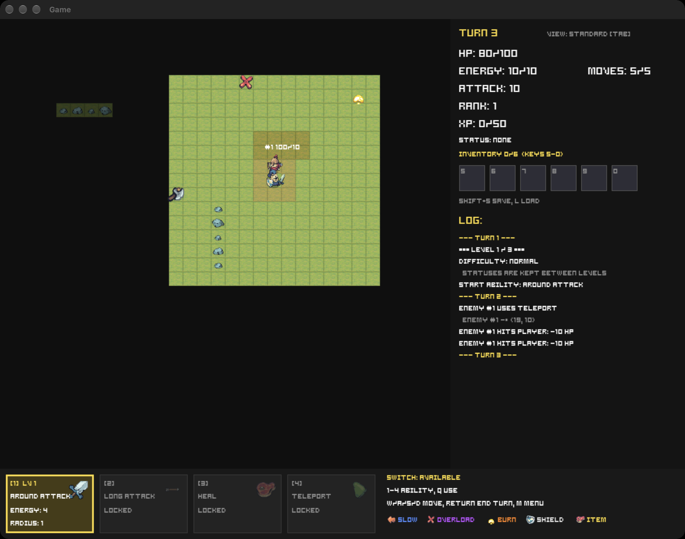

</div>

---

## 📑 Содержание

- [О проекте](#-о-проекте)
- [Скриншоты](#-скриншоты)
- [Возможности игры](#-возможности-игры)
- [Управление](#-управление)
- [Архитектура](#-архитектура)
- [UML-диаграмма всего кода](#-uml-диаграмма-всего-кода)
- [Сборка и запуск](#-сборка-и-запуск)
- [Файлы уровней, сохранения и журнал](#-файлы-уровней-сохранения-и-журнал)
- [Структура папки](#-структура-папки)

---

## 🎯 О проекте

Одна игра, которая развивается от лабораторной к лабораторной. Игрок управляет одним роботом на клеточном поле: ходит, сражается с вражескими роботами, лечит союзников, собирает предметы и повышает ранг. Каждая следующая работа добавляет новый слой ООП: от классов и инкапсуляции к интерфейсам и полиморфизму, а затем к шаблонам и разделению на независимые подсистемы.

| | Лабораторная | Что добавлено | Ключевые идеи ООП |
|:-:|---|---|---|
| 1️⃣ | [**lab 1**](lab%201) — основа игры | Робот с характеристиками и рангами, поле с проходимыми и непроходимыми клетками, пошаговый цикл, заводы роботов, скорость и туман войны, редактор карт | Классы, инкапсуляция, контроль инвариантов, отделение отрисовки от модели |
| 2️⃣ | [**lab 2**](lab%202) — способности и статусы | 4 способности с улучшениями, 6 статусов, клетки со статусами, инвентарь и зелья, ИИ врагов, графика на спрайтах | Интерфейсы (чисто виртуальные классы), наследование, полиморфизм, каталоги-фабрики |
| 3️⃣ | [**lab 3**](lab%203) — полноценная игра | Шаблонный класс игры с 3 режимами, меню, выбор сложности с модификаторами, сохранение и загрузка с проверкой целостности, журнал с уровнями, настраиваемое управление | Шаблоны классов, разделение ввода, отрисовки и логики, сериализация, слушатели событий |

> [!NOTE]
> Актуальная версия кода — **lab 3**: по ней построены описание и большая UML-диаграмма ниже. Подробности по каждой работе — в отчётах (`*.docx`) внутри папок.

---

## 📸 Скриншоты

### Lab 3 — текущая версия

<table>
  <tr>
    <td width="50%">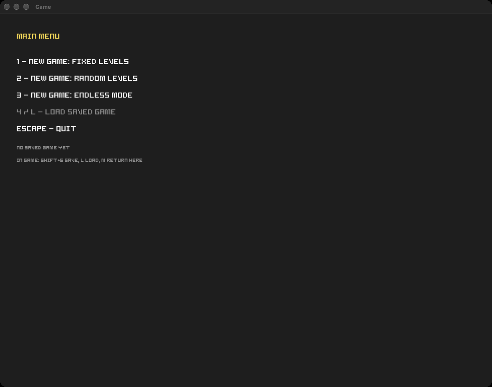<br><sub><b>Главное меню</b> — три режима и загрузка сохранения</sub></td>
    <td width="50%">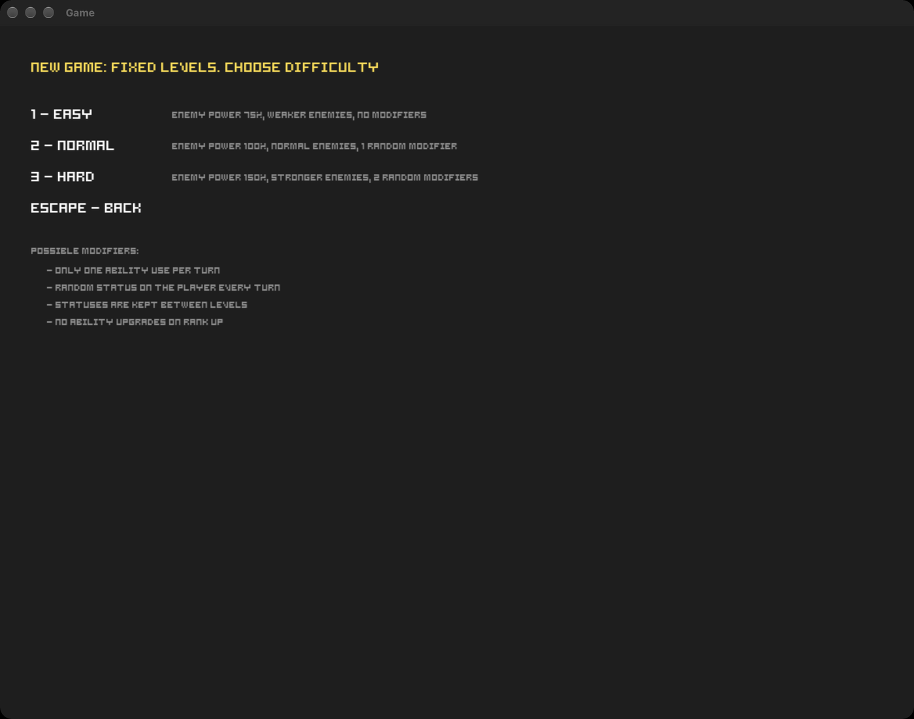<br><sub><b>Выбор сложности</b> — сила врагов и случайные модификаторы</sub></td>
  </tr>
  <tr>
    <td width="50%">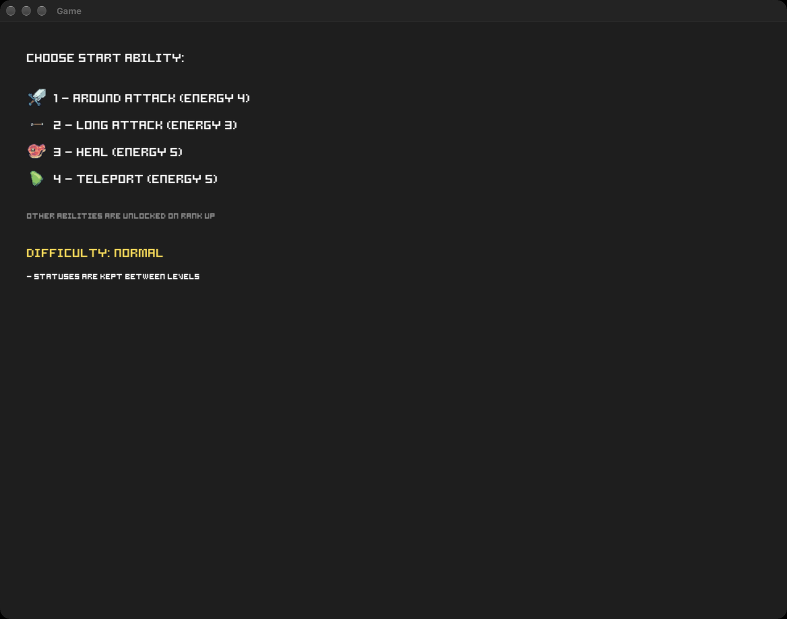<br><sub><b>Стартовая способность</b> — остальные открываются с ростом ранга</sub></td>
    <td width="50%">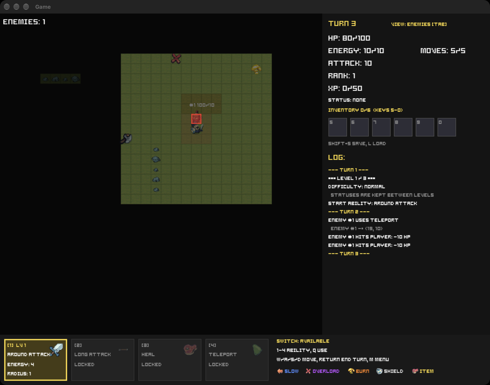<br><sub><b>Режимы подсветки поля</b> (Tab): враги, препятствия, клетки со статусами</sub></td>
  </tr>
</table>

### Как игра выглядела раньше

<table>
  <tr>
    <td width="50%">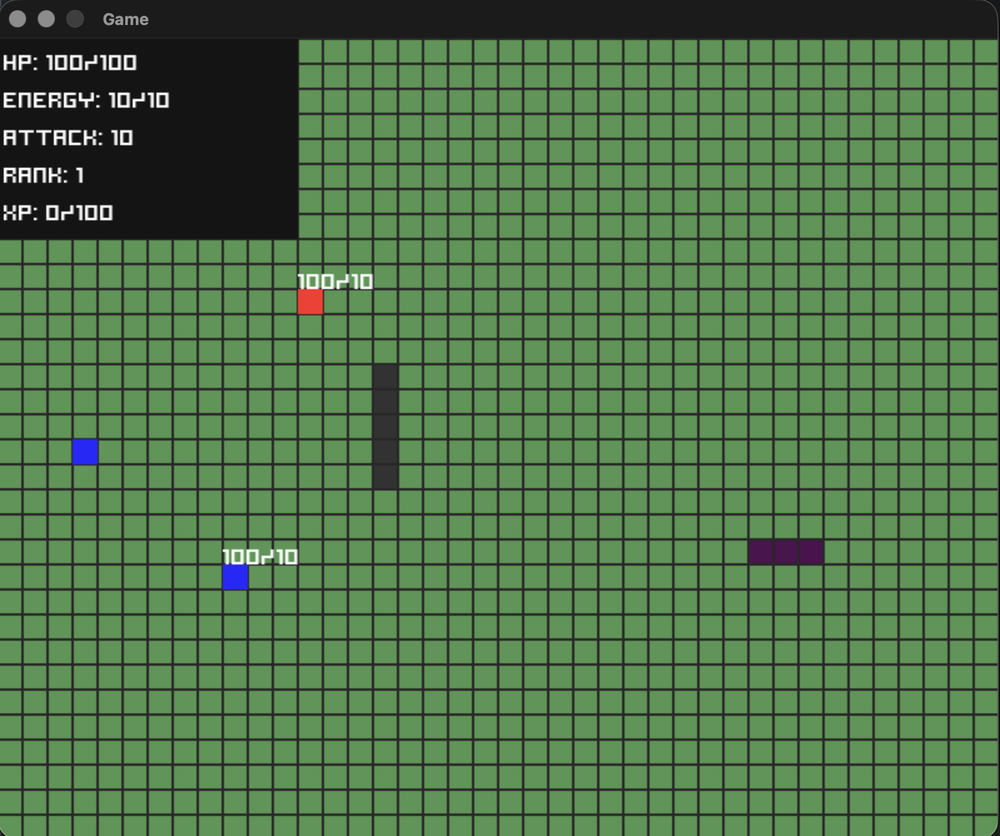<br><sub><b>Lab 1</b> — первая версия: цветные клетки и текстовая панель</sub></td>
    <td width="50%">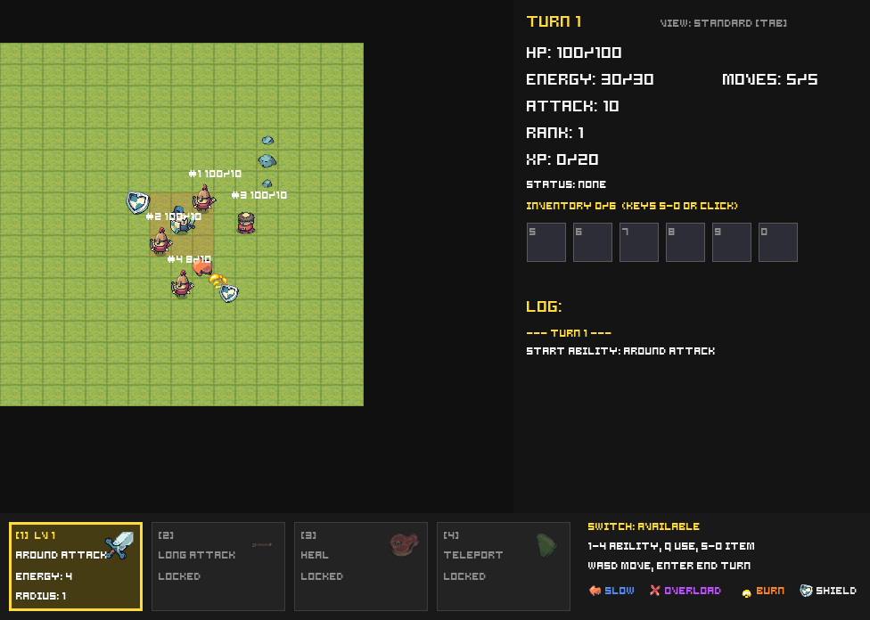<br><sub><b>Lab 2</b> — спрайты, панель способностей, инвентарь и журнал</sub></td>
  </tr>
</table>

---

## 🎮 Возможности игры

**Режимы.** Все три собраны из одного шаблона `Game_template<Level_generator, Level_count>`:

| Режим | Уровни | Шаблон |
|---|---|---|
| Fixed levels | 3 уровня из файлов `levels/level_N.txt` | `Game_template<File_level_generator, 3>` |
| Random levels | 5 случайных уровней, каждый сложнее предыдущего | `Game_template<Random_level_generator, 5>` |
| Endless mode | Случайные уровни без конца, игра идёт до поражения | `Game_template<Random_level_generator, kEndless_levels>` |

При переходе на следующий уровень робот игрока сохраняет ранг, опыт, здоровье, способности с улучшениями и инвентарь. Энергия восстанавливается, а статусы снимаются.

**Сложность.** Easy, Normal и Hard дают врагам 75%, 100% и 150% силы и добавляют 0, 1 или 2 случайных модификатора:
- только одно применение способности за ход;
- каждый ход на игрока накладывается случайный статус;
- статусы сохраняются между уровнями;
- способности нельзя улучшать при повышении ранга.

**Способности.** Каждая расходует энергию и улучшается при повышении ранга:

| Способность | Действие | Улучшение |
|---|---|---|
| ⚔️ Around attack | Урон всем в радиусе и статус Overload | + радиус |
| 🏹 Long attack | Урон одной цели в радиусе 3 и статус Burn | + урон |
| ❤️ Heal | Восстанавливает здоровье себе; лечение сверх максимума превращается в щит | + лечение |
| 🌀 Teleport | Перемещение на свободную клетку в радиусе 5 | − стоимость |

**Статусы:** 🐌 Slow, ✖️ Overload, 🔥 Burn, 🛡️ Shield, 💪 Strength, 🎁 Item pickup. Их накладывают способности и клетки поля. Повторные статусы складываются по своим правилам: горение продлевается, щиты суммируются, перегрузка не копится.

**Прочее:** инвентарь на 6 предметов (зелья атаки, энергии и здоровья), заводы, которые периодически создают врагов, туман войны с запоминанием увиденных препятствий, труднопроходимые клетки, ИИ врагов, журнал событий на экране.

---

## ⌨️ Управление

Раскладка читается из [`lab 3/src/controls.txt`](lab%203/src/controls.txt). Можно назначать сочетания клавиш вида `Shift+S` или `Ctrl+Shift+F5`. Если файл некорректен (команда без клавиши, одна клавиша на две команды и т. п.), включается управление по умолчанию, а игра показывает предупреждение.

| Действие | Клавиша | | Действие | Клавиша |
|---|:-:|---|---|:-:|
| Движение | `W` `A` `S` `D` | | Выбор способности / пункта меню | `1`–`4` |
| Применить способность | `Q` | | Использовать предмет | `5`–`0` |
| Отмена / выход | `Esc` | | Режим подсветки поля | `Tab` |
| Конец хода | `Enter` | | Выйти в меню | `M` |
| Сохранить | `Shift+S` | | Загрузить | `L` |

---

## 🏛 Архитектура

Игра не знает ни про SDL, ни про файлы. Она получает готовые команды и отдаёт своё состояние. Ввод, отрисовка, сохранение и журнал — отдельные подсистемы, связанные через узкие интерфейсы и параметры шаблонов.

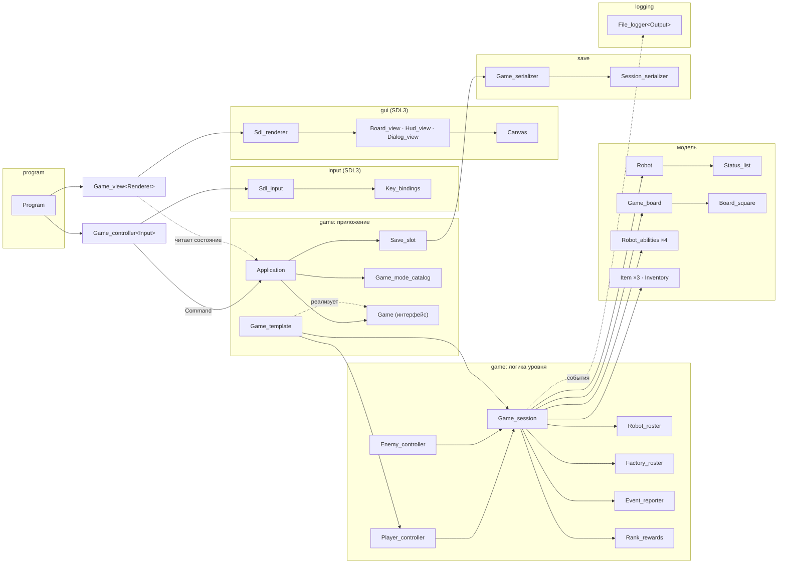

Путь одного нажатия: `Sdl_input` превращает клавишу в `Command` → `Game_controller` передаёт её в `Application::handle` → приложение обрабатывает меню, сохранение и загрузку само либо отдаёт команду в `Game::handle` → `Player_controller` вызывает метод `Game_session` → сессия пишет событие в журнал на экране и оповещает слушателя, который передаёт его в `File_logger`. На следующем кадре `Game_view` читает новое состояние и рисует его.

<details>
<summary><b>Используемые приёмы и паттерны</b></summary>

| Приём | Где |
|---|---|
| Шаблон класса со стратегией-параметром | `Game_template<Level_generator, Level_count>`, `File_logger<Output>` |
| Статический полиморфизм (утиная типизация шаблонов) | `Game_controller<Input>`, `Game_view<Renderer>` |
| Интерфейсы и динамический полиморфизм | `Game`, `Robot_abilities`, `Robot_status`, `Item`, `Logger`, `Game_event_listener` |
| Наблюдатель | `Game_event_listener` → `Game_log_listener` → `Logger` |
| Фабрики и каталоги | `Game_mode_catalog`, `Ability_catalog`, `Item_catalog`, `Robot_factory`, `Unit_presets` |
| Строитель | `Map_editor` собирает `Game_session` |
| Команда | перечисление `Command` — единственный канал от ввода к игре |
| Сериализация по частям | `Game_serializer` → `Session_serializer` → `Board_` / `Robot_` / `Status_serializer` |

</details>

---

## 🧬 UML-диаграмма всего кода

Полная диаграмма классов lab 3: **83 класса, 11 перечислений, 128 связей, все поля и методы**, сгруппированные по модулям. Она сгенерирована автоматически по заголовкам, поэтому совпадает с кодом.

<p align="center">
  <a href="docs/uml/lab3_full.svg">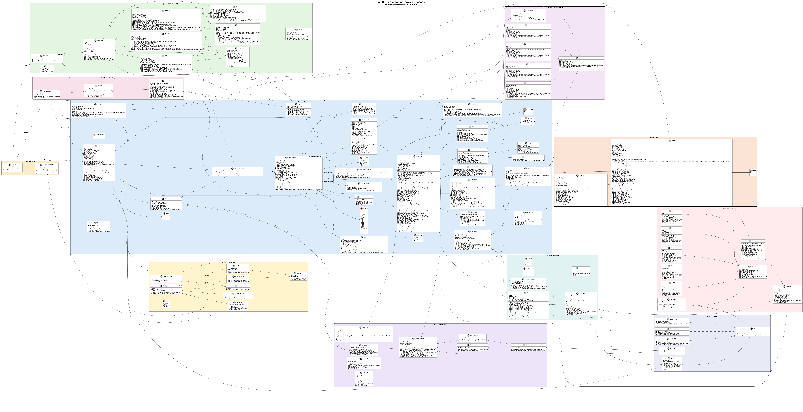</a>
</p>

<p align="center"><sub>🔍 Нажмите на картинку, чтобы открыть векторную версию (SVG) — её удобно масштабировать. Есть также <a href="docs/uml/lab3_full.png">PNG 9616×4946</a> и <a href="docs/uml/lab3_full.puml">исходник PlantUML</a>.</sub></p>

**Обозначения:** `◆—` композиция (владеет), `◇—` агрегация (ссылка или указатель), `—▷` наследование, `┄▷` реализация интерфейса, `┄>` зависимость или параметр шаблона. Видимость: `+` public, `#` protected, `-` private. Цвет фона показывает модуль.

<details>
<summary><b>Диаграммы подсистем lab 3 (из отчёта, крупнее и проще)</b></summary>

#### Приложение, режимы и уровень
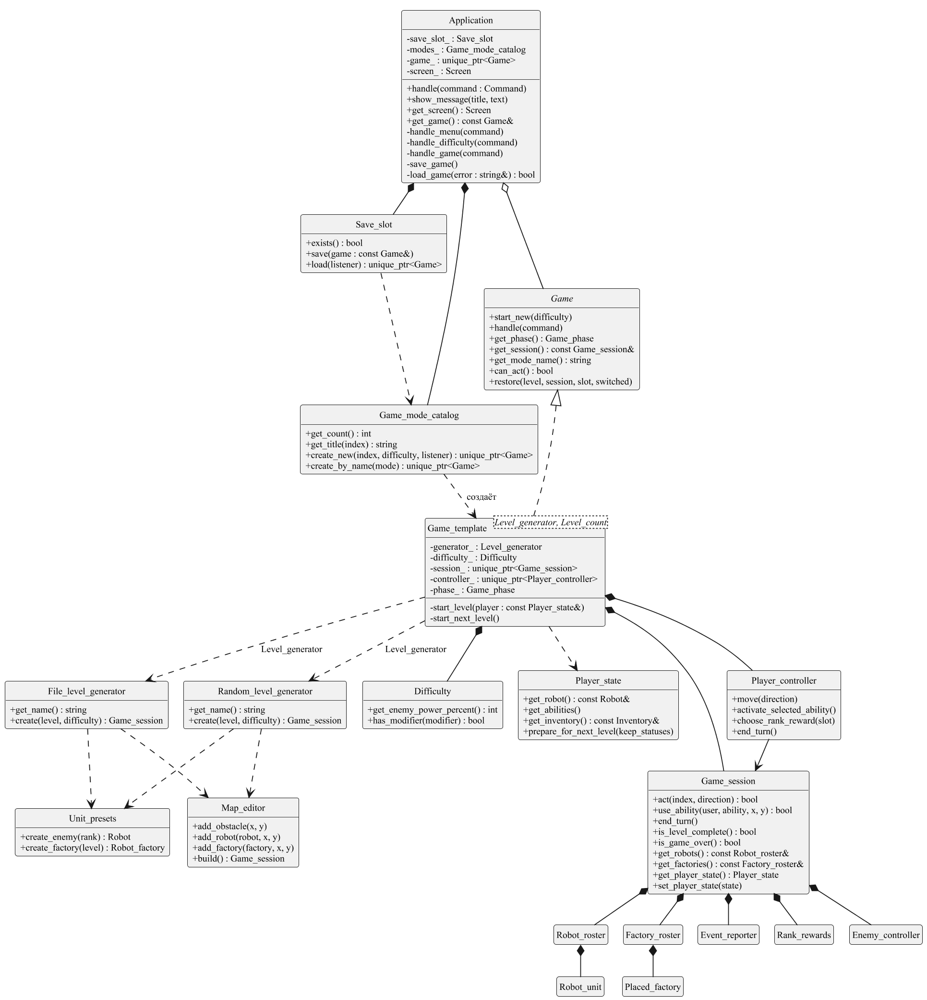

#### Запуск, ввод и отрисовка
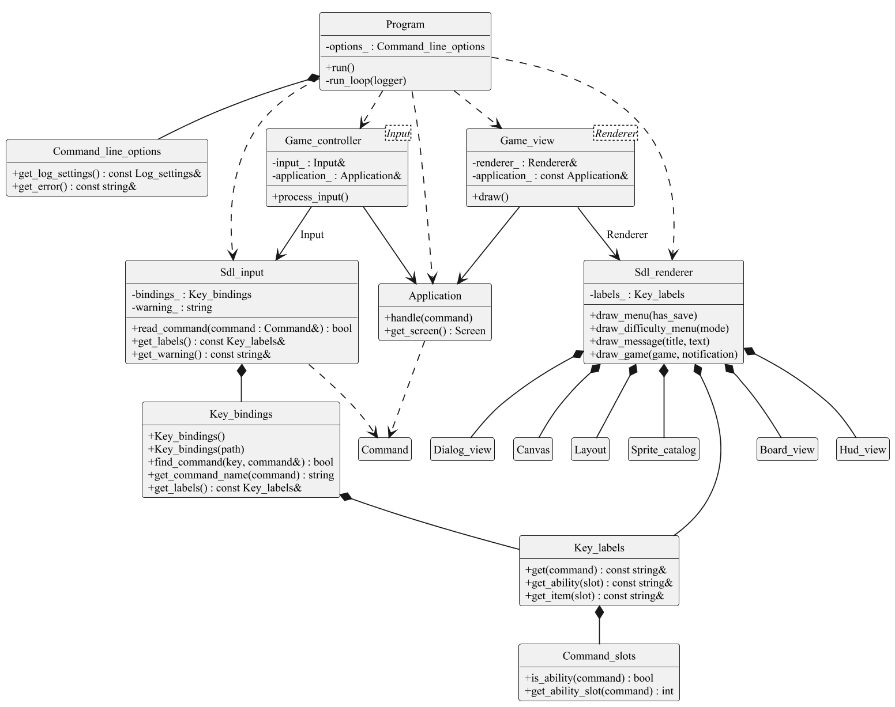

#### Сохранение и журнал
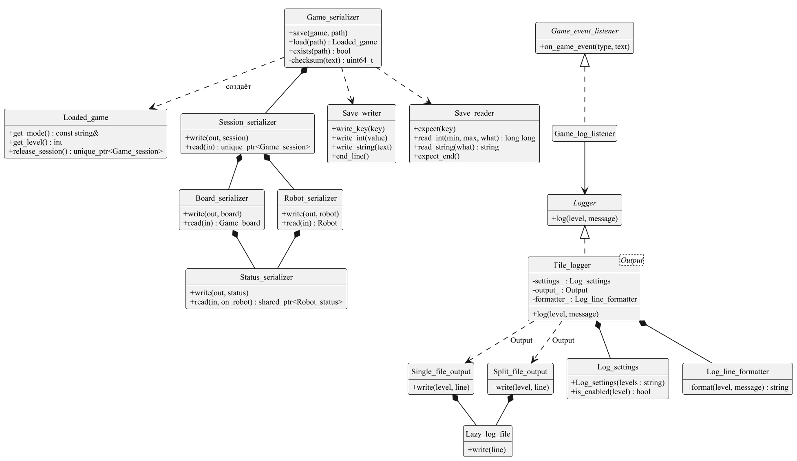

</details>

<details>
<summary><b>UML lab 1 и lab 2</b></summary>

#### Lab 1
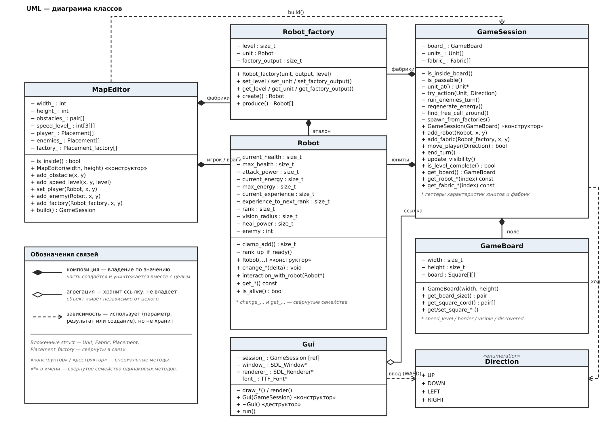

#### Lab 2 — модель и игровая логика
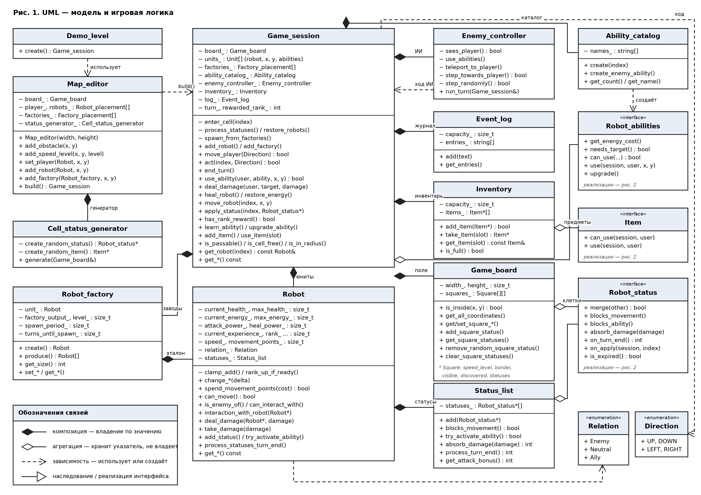

#### Lab 2 — способности, статусы и предметы
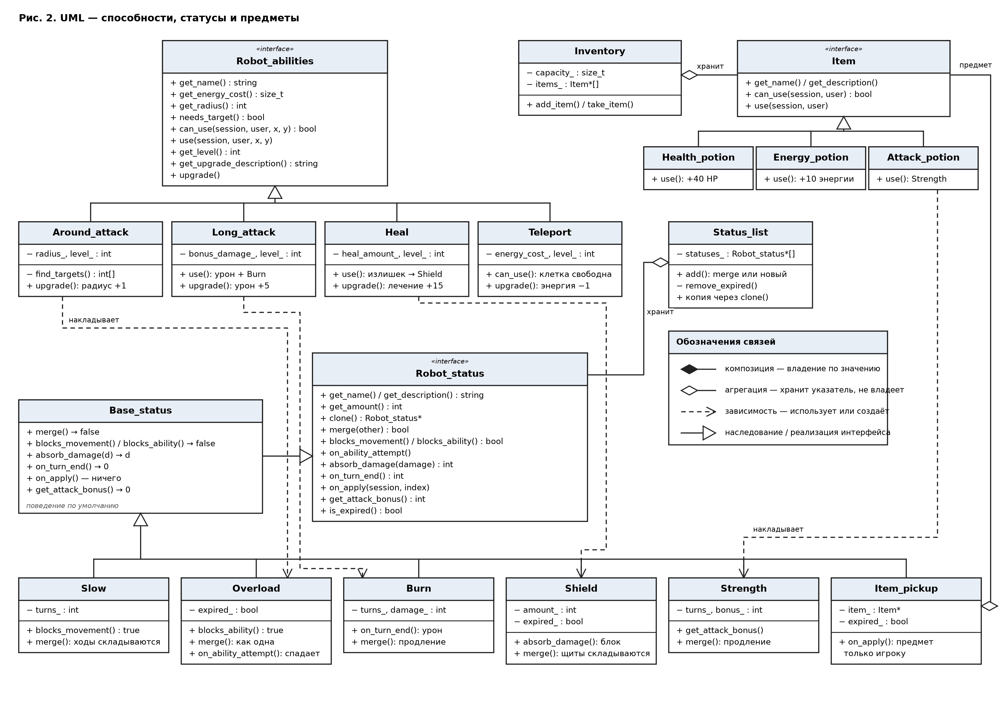

#### Lab 2 — визуализация и управление
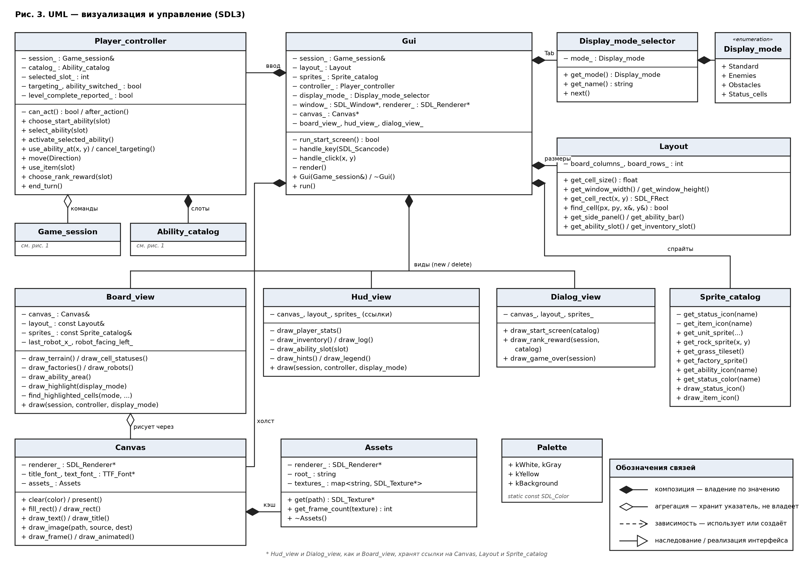

</details>

<details>
<summary><b>Как перегенерировать диаграмму</b></summary>

Скрипт [`docs/uml/gen_uml.py`](docs/uml/gen_uml.py) разбирает все `*.h` в `lab 3/src`: классы, шаблоны, наследование, поля, методы. Связи он выводит по типам полей. Рендер выполняет [PlantUML](https://plantuml.com) со встроенной раскладкой Smetana, Graphviz не нужен.

```bash
cd OOP
python3 docs/uml/gen_uml.py "lab 3/src" docs/uml/lab3_full.puml
```

</details>

---

## 🔨 Сборка и запуск

**Нужно:** компилятор с поддержкой C++20 (Clang, GCC или MSVC) и CMake 3.20+. SDL3 и SDL3_ttf собираются из исходников, они лежат в `lab 1/vendor`.

```bash
cd "OOP/lab 3"
cmake -S . -B build -DCMAKE_BUILD_TYPE=Debug
cmake --build build -j
./build/src/OOP_Project            # Windows: build\src\OOP_Project.exe
```

> [!TIP]
> Если рядом с проектом нет папки `vendor/`, `lab 3/CMakeLists.txt` сам подключает SDL из `../lab 1/vendor`. В CLion достаточно открыть папку `lab 3` и выбрать конфигурацию запуска **OOP_Project**.

**Уровни журнала** задаются аргументом командной строки:

```bash
./OOP_Project --log=all                         # по умолчанию
./OOP_Project --log=none
./OOP_Project --log=program_info,game_error     # любая комбинация
```

Доступные уровни: `program_info`, `game_info`, `program_error`, `game_error`.

---

## 📂 Файлы уровней, сохранения и журнал

**Уровни** (`lab 3/src/levels/level_N.txt`) — текстовые карты, один символ на клетку:

| Символ | Значение | Символ | Значение |
|:-:|---|:-:|---|
| `.` | пустая клетка | `P` | игрок (обязателен) |
| `#` | препятствие | `E`, `2`–`9` | враг ранга 1 или 2–9 |
| `~` | труднопроходимая клетка | `A` | союзник |
| `F` | завод роботов | `s` `o` `b` `h` `i` | клетка со статусом: Slow, Overload, Burn, Shield, предмет |

**Сохранение** (`save.txt` в папке сборки) — текстовый файл с заголовком `ROBOT_GAME_SAVE`, версией и контрольной суммой FNV-1a. Запись идёт через временный файл. Испорченный или обрезанный файл не загрузится, а игра останется в том состоянии, в котором была до попытки загрузки.

**Журнал** (папка сборки): `info.log` для информации и `errors.log` для ошибок (`File_logger<Split_file_output>`). Если подставить `Single_file_output`, всё будет писаться в один `game.log`.

---

## 🗂 Структура папки

```
OOP/
├── README.md
├── docs/
│   ├── screenshots/           # скриншоты всех трёх версий
│   └── uml/                   # диаграммы, генератор и исходник PlantUML
│
├── lab 1/                     # основа игры
│   ├── отчет.docx
│   ├── src/                   # Robot, Robot_factory, Game_board, GameSession, MapEditor, GUI
│   └── vendor/                # исходники SDL3 и SDL3_ttf (не авторский код)
│
├── lab 2/                     # способности, статусы, предметы, спрайты
│   ├── Отчет ЛР2.docx
│   └── src/                   # abilities, board, game, gui, items, robot, statuses
│
└── lab 3/                     # шаблонная игра, ввод, отрисовка, сохранение, журнал
    ├── Отчет ЛР3.docx
    ├── CMakeLists.txt
    └── src/
        ├── program/           # Program, Command_line_options — точка входа
        ├── game/              # Application, Game_template, Game_session, генераторы уровней…
        ├── input/             # Sdl_input, Key_bindings
        ├── gui/               # Sdl_renderer, Board_view, Hud_view, Dialog_view, Canvas…
        ├── save/              # Game_serializer и сериализаторы частей
        ├── logging/           # Logger, File_logger<Output>, Log_settings
        ├── robot/  board/  abilities/  statuses/  items/
        ├── levels/            # level_1.txt … level_3.txt
        ├── controls.txt       # раскладка клавиш
        ├── assets/            # спрайты Tiny Swords (Free Pack)
        └── fonts/             # Samson.ttf
```

---

<div align="center">
<sub>Учебный проект · СПбГЭТУ «ЛЭТИ» · спрайты — <a href="https://pixelfrog-assets.itch.io/tiny-swords">Tiny Swords (Free Pack)</a> by Pixel Frog</sub>
</div>
