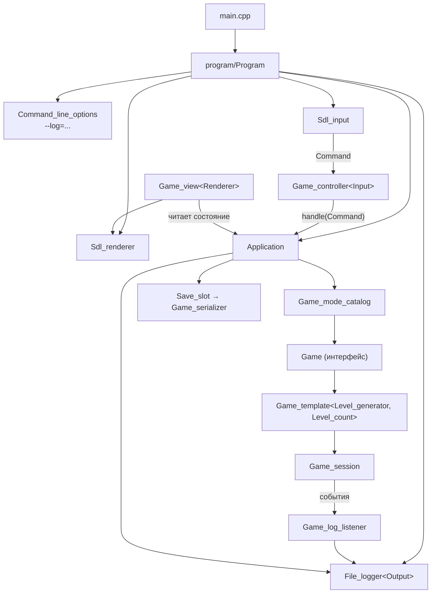
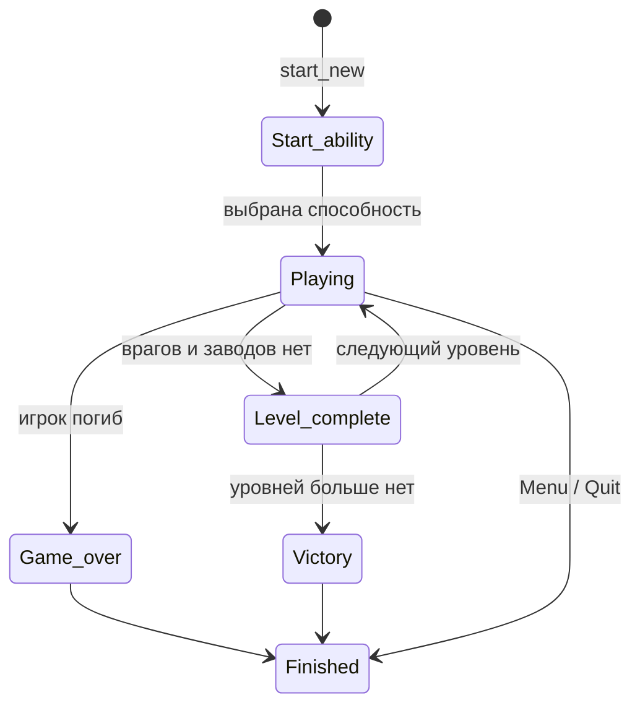
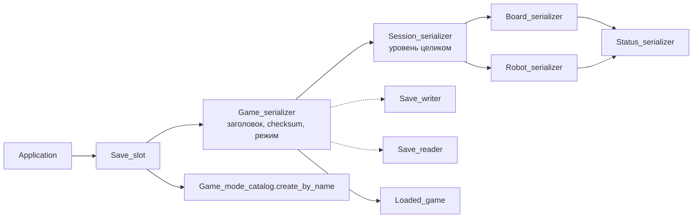

# Разбор лабораторной работы №3

> [!info] О проекте
> Пошаговая тактическая игра с роботами на C++20 с графикой на SDL3 + SDL3_ttf.
> Все пути ниже даны относительно папки `OOP/lab 3/src/`. Запись `file.cpp:42` означает строку 42 в этом файле.
> Номера строк соответствуют текущему состоянию рабочей копии (изменения пока не закоммичены).

> [!warning] Сборка
> `src/CMakeLists.txt` подключает библиотеку `vendor` (SDL3, SDL3_ttf), но папки `vendor/` в проекте нет. Без неё проект не соберётся. Перед сдачей её нужно вернуть.

## Содержание

1. [[#Общая архитектура]]
2. [[#Задание 1. Шаблонный класс игры]]
3. [[#Задание 2. Ввод и визуализация]]
4. [[#Задание 3. Сохранение и загрузка]]
5. [[#Задание 4. Сложность и модификаторы]]
6. [[#Задание 5. Логирование]]
7. [[#Требования к стилю кода]]
8. [[#Точка входа и запуск]]
9. [[#Карта файлов по папкам]]
10. [[#Вопросы для защиты]]

---

## Общая архитектура



**Главная идея:** игра (`Game`, `Game_template`, `Game_session`) ничего не считывает, не рисует и не пишет в файлы. Она только:
- принимает команды (`enum class Command`);
- отдаёт своё состояние через const-методы;
- сообщает о событиях наблюдателю (`Game_event_listener`).

Ввод, визуализация, сохранение и логирование подключаются снаружи.

| Паттерн | Где применён |
|---|---|
| **Command** | `game/includes/Command.h` — все действия пользователя сведены к командам |
| **Template / Policy** | `Game_template<Level_generator, Level_count>`, `Game_controller<Input>`, `Game_view<Renderer>`, `File_logger<Output>` |
| **Observer** | `Game_event_listener` → `Game_log_listener` → `Logger` |
| **State machine** | `Game_phase` в `Game_template`, `Screen` в `Application` |
| **Factory / каталог** | `Game_mode_catalog`, `Ability_catalog`, `Item_catalog`, `Unit_presets` |
| **Builder** | `Map_editor` собирает `Game_session` из описания карты |

---

## Задание 1. Шаблонный класс игры

> [!quote] Требование
> Шаблонный класс игры: фиксированные уровни из файлов, случайные уровни с растущей сложностью, бесконечный режим. Между уровнями игрок сохраняет ранг, способности с улучшениями, опыт и HP. Энергия восстанавливается, статусы снимаются. Меню: новая игра / загрузка.

### Интерфейс `Game`

**Файл:** `game/includes/Game.h:18`. Интерфейс нужен, чтобы приложение работало с любой конкретизацией шаблона одинаково.

| Метод | Строка | Назначение |
|---|---|---|
| `start_new(const Difficulty&)` | `Game.h:24` | новая игра с первого уровня |
| `handle(Command)` | `Game.h:25` | единственный вход для действий |
| `get_phase()` | `Game.h:27` | текущий этап (`Game_phase`) |
| `get_level()`, `get_level_count()` | `Game.h:29-30` | номер уровня и их количество (0 — бесконечный режим) |
| `get_session()`, `get_controller()`, `get_display_mode()` | `Game.h:32-34` | состояние для отрисовки и сохранения |
| `set_event_listener(...)` | `Game.h:37` | наблюдатель за событиями |
| `get_mode_name()` | `Game.h:40` | имя режима для сохранения, например `random_5` |
| `can_act()` | `Game.h:42` | можно ли сейчас сохраняться и загружаться |
| `restore(level, session, slot, switched)` | `Game.h:46` | приём восстановленного состояния |

### Шаблон `Game_template<Level_generator, Level_count>`

**Файл:** `game/includes/Game_template.h:35`. Это header-only класс, потому что он шаблонный.

- `Level_generator` — класс с методами `get_name()` и `create(int level, const Difficulty&)`. Требования к нему описаны в комментарии в `Game_template.h:25-29`.
- `Level_count` — число уровней. Константа `kEndless_levels = 0` (`Game_template.h:18`) включает бесконечный режим. `static_assert` в `Game_template.h:37` запрещает отрицательные значения.

| Метод | Строка | Что делает |
|---|---|---|
| `is_endless()` | `:51` | `Level_count == kEndless_levels` |
| `get_level_title()` | `:55` | заголовок «=== Level N / M ===» для журнала |
| `start_level(const Player_state&)` | `:63` | создаёт сессию через генератор, переносит в неё игрока, создаёт `Player_controller` и выбирает фазу (`Start_ability` или `Playing`) |
| `start_next_level()` | `:79` | **переход между уровнями**: берёт `Player_state`, вызывает `prepare_for_next_level(...)`, при последнем уровне ставит `Victory`, иначе запускает `level_ + 1` |
| `handle_start_ability(Command)` | `:94` | выбор стартовой способности |
| `handle_playing(Command)` | `:104` | раздаёт команды `Player_controller`, проверяет `Game_over` и `Level_complete` |
| `start_new(...)` | `:143` | уровень 1, `Player_state()` — стартовый робот |
| `handle(Command)` | `:150` | конечный автомат по `Game_phase` |
| `get_mode_name()` | `:215` | `generator_.get_name() + "_" + count` |
| `can_act()` | `:220` | `Playing` и нет невыбранной награды за ранг |
| `restore(...)` | `:224` | **сначала проверяет всё, потом меняет состояние**, поэтому игра не портится при ошибке |

**Конечный автомат фаз** (`game/includes/Game_phase.h:5`):



### Режимы игры: `Game_mode_catalog`

**Файлы:** `game/includes/Game_mode_catalog.h:13`, `game/Game_mode_catalog.cpp`. Это единственное место, где перечислены режимы.

| Номер | Название | Конкретизация шаблона | Строка |
|---|---|---|---|
| 0 | fixed levels | `Game_template<File_level_generator, 3>` | `Game_mode_catalog.cpp:27` |
| 1 | random levels | `Game_template<Random_level_generator, 5>` | `:30` |
| 2 | endless mode | `Game_template<Random_level_generator, kEndless_levels>` | `:33` |

- `create(index)` (`:25`) — пустая игра.
- `create_new(index, difficulty, listener)` (`:38`) — подключает слушателя **до** старта, чтобы в журнал попали события первого уровня.
- `create_by_name(mode)` (`:47`) — для загрузки: ищет режим по `get_mode_name()`.

> [!tip] Масштабируемость
> Новый режим добавляется одной веткой в `create()` и строкой в `kModeTitles`. Меню (`gui/Dialog_view.cpp`) строит список режимов из каталога само.

### Генераторы уровней

#### `File_level_generator` — фиксированные уровни из файлов

- **Файлы:** `game/includes/File_level_generator.h:16`, `game/File_level_generator.cpp`.
- Карты лежат в `levels/level_1.txt` … `level_3.txt`. Путь к папке задаёт макрос `LEVELS_PATH` из CMake.
- Легенда символов приведена в комментарии `File_level_generator.h:9-15`: `.` пусто, `#` стена, `~` вязкая клетка, `P` игрок, `A` союзник, `E`/`2..9` враги, `F` завод, `s o b h i` статусы и предмет.
- `create(level_number, difficulty)` (`File_level_generator.cpp:23`):
  - читает файл и проверяет одинаковую длину строк и наличие игрока;
  - при ошибке бросает `runtime_error`;
  - силу врагов масштабирует через `Unit_presets(difficulty.get_enemy_power_percent())`.

#### `Random_level_generator` — случайные уровни с растущей сложностью

- **Файлы:** `game/includes/Random_level_generator.h:14`, `game/Random_level_generator.cpp`.
- Рост сложности задан в `create(...)` (`Random_level_generator.cpp:37`):

| Что растёт с уровнем | Формула | Строки |
|---|---|---|
| шанс статусов на клетках | `min(8 + 3·(level−1), 25)` и `min(2 + 2·(level−1), 10)` | `:43-44` |
| число стен | `min(6 + level, 16)` | `:45` |
| число заводов | `min((level+1)/2, 4)` | `:57` |
| сила заводов | `units.create_factory(level)` | `:59` |
| число врагов | `min(2 + level, 12)` | `:65` |
| ранг врагов | `level + rand() % 2` | `:68` |

- Вспомогательные методы: `find_free_cell` (`:80`), `mark` (`:104`), `add_walls` (`:112`), `add_slow_areas` (`:129`).

#### Вспомогательные классы генерации

- **`Unit_presets`** (`game/includes/Unit_presets.h:12`, `game/Unit_presets.cpp`) — шаблоны врагов, союзников и заводов:
  - `create_enemy(rank)` (`:24`), `create_ally()` (`:36`), `create_factory(level)` (`:40`);
  - `scale(value)` (`:20`) применяет процент силы сложности.
- **`Map_editor`** (`game/includes/Map_editor.h:17`, `game/Map_editor.cpp`) — Builder. Накапливает стены, клетки, роботов и заводы, а `build()` собирает готовую `Game_session`.

### Перенос игрока между уровнями: `Player_state`

**Файлы:** `game/includes/Player_state.h:16`, `game/Player_state.cpp`.

> [!important] Что переносится
> Робот (ранг, опыт, HP), способности **теми же объектами** (поэтому улучшения сохраняются) и инвентарь.

- `Player_state()` (`Player_state.cpp:9`) — стартовый робот, пустой инвентарь.
- `Player_state(robot, abilities, inventory)` (`:13`) — **проверяет инвариант**. Бросает `invalid_argument`, если:
  - робот не нейтральный;
  - есть пустая или повторяющаяся способность;
  - вместимость инвентаря не равна `kInventoryCapacity = 6`.
- `prepare_for_next_level(bool keep_statuses)` (`:46`):
  - снимает статусы (если не `keep_statuses`);
  - восстанавливает энергию (`reset_energy`) и очки движения.
- Где используется:
  - `Game_session::get_player_state()` (`game/Game_session.cpp:542`) и `set_player_state()` (`:546`);
  - `Game_template::start_next_level()` (`Game_template.h:79`).

### Игровая сессия (один уровень)

`Game_session` (`game/includes/Game_session.h`, `game/Game_session.cpp`) хранит правила уровня. Хранение данных вынесено в отдельные классы.

| Класс | Файл | Ответственность |
|---|---|---|
| `Game_session` | `game/Game_session.cpp` | правила: ход `act` (`:102`), атака завода `attack_factory` (`:134`), взаимодействие `interact` (`:153`), шаг `step` (`:184`), конец хода `end_turn` (`:230`), способности `use_ability` (`:386`) |
| `Robot_unit` | `game/includes/Robot_unit.h` | робот + координаты + способности |
| `Robot_roster` | `game/includes/Robot_roster.h` | все роботы уровня, игрок под `kPlayerIndex = 0` |
| `Placed_factory` | `game/includes/Placed_factory.h` | завод + координаты |
| `Factory_roster` | `game/includes/Factory_roster.h` | все заводы уровня |
| `Event_reporter` | `game/includes/Event_reporter.h` | журнал на экране + пересылка слушателю |
| `Rank_rewards` | `game/includes/Rank_rewards.h` | награды за ранг |
| `Player_controller` | `game/includes/Player_controller.h` | выбранная способность, прицел, автоконец хода |
| `Enemy_controller` | `game/includes/Enemy_controller.h` | ИИ врагов и союзников |

### Меню «новая игра / загрузка»

Меню реализует `Application::handle_menu` (`game/Application.cpp:30`):
- слоты `Ability_1..` выбирают режим, после чего открывается экран `Difficulty_select`;
- слот после режимов или `Load` загружает сохранение;
- `Cancel` выходит из программы.

Экраны перечислены в `game/includes/Screen.h:5`.

---

## Задание 2. Ввод и визуализация

> [!quote] Требование
> Системы ввода и отрисовки независимы друг от друга. В игровых классах нет ни ввода, ни отрисовки — только передача команд. Управление читается из файла. При некорректном файле (нет команды, повтор клавиши, несколько клавиш на одну команду) используется управление по умолчанию, а пользователь получает уведомление.

### Команды

- **`enum class Command`** — `game/includes/Command.h:7`: движение, способность, отмена, конец хода, `Ability_1..4`, `Item_1..6`, `Switch_display`, `Menu`, `Save`, `Load`, `Quit`.
- `kBindableCommandCount` (`Command.h:33`) — сколько команд можно назначить на клавиши (все, кроме `Quit`).
- **`Command_slots`** (`game/includes/Command_slots.h:8`, `game/Command_slots.cpp`) переводит команды-слоты в номера и обратно:
  - `is_ability` (`:19`), `is_item` (`:23`);
  - `get_ability_slot` (`:27`), `get_item_slot` (`:34`);
  - `get_ability_command` (`:41`), `get_item_command` (`:48`).

### Система ввода (`input/`)

| Класс | Файл | Роль |
|---|---|---|
| `Game_controller<Input>` | `input/includes/Game_controller.h:12` | шаблон-связка: в `process_input()` (`:22`) забирает команды у `Input` и передаёт в `Application::handle`. Об SDL ничего не знает |
| `Sdl_input` | `input/includes/Sdl_input.h:13`, `input/Sdl_input.cpp` | превращает события SDL в `Command`. `read_command` (`Sdl_input.cpp:32`) не блокирует; закрытие окна даёт `Quit` |
| `Key_bindings` | `input/includes/Key_bindings.h:16`, `input/Key_bindings.cpp` | таблица «клавиша ↔ команда», чтение и проверка файла |

Требования к параметру `Input` описаны в `Game_controller.h:9-10`: метод `bool read_command(Command&)`, который не ждёт ввода.

### Файл управления и проверка

**Файл:** `src/controls.txt`. Формат — строки `<команда> <клавиша>`, `#` начинает комментарий.

Как идёт проверка в `Key_bindings`:

| Ситуация | Где обнаруживается |
|---|---|
| файла нет | `Key_bindings.cpp:32` — `cannot open` |
| неверный формат строки | `:54` |
| неизвестная команда | `:64` |
| на команду не назначена клавиша | `:45` — `no key for command` |
| несколько клавиш на одну команду | `:93` — `has several keys` |
| одна клавиша на несколько команд | `:97` — `is bound to several commands` |
| клавиши не существует в SDL | `Sdl_input.cpp:16-19` (`SDL_GetScancodeFromName`) |

- Конструктор по умолчанию `Key_bindings()` (`Key_bindings.cpp:23`) задаёт управление по умолчанию из `kDefaultKeys` (`:16`).
- Конструктор `Key_bindings(const std::string& path)` (`:29`) читает файл; при любой ошибке бросает `runtime_error`.

**Откат на управление по умолчанию и уведомление** — `Sdl_input::Sdl_input` (`Sdl_input.cpp:10-26`):
1. В `try` строится `Key_bindings loaded(config_path)`.
2. При исключении в `bindings_` остаются значения по умолчанию, а текст ошибки сохраняется в `warning_` (`:23`).
3. `Program::run_loop` (`program/Program.cpp:41`) пишет предупреждение в журнал как `Program_error` и показывает экран-сообщение через `Application::show_message("Controls", ...)`.

### Независимость ввода и отрисовки: `Key_labels`

Визуализации нужны подписи клавиш («Q — способность»), но доступа к системе ввода у неё быть не должно. Поэтому есть отдельный класс-данные **`Key_labels`** (`game/includes/Key_labels.h:13`, `game/Key_labels.cpp`):
- методы `set` (`:8`), `has` (`:12`), `get` (`:16`), `get_ability` (`:24`), `get_item` (`:28`), `get_all` (`:32`);
- `Sdl_input::get_labels()` отдаёт копию, а `Sdl_renderer(const Key_labels&)` её хранит;
- ссылок между вводом и отрисовкой нет.

### Система визуализации (`gui/`)

| Класс | Файл | Роль |
|---|---|---|
| `Game_view<Renderer>` | `gui/includes/Game_view.h:14` | шаблон-связка: `draw()` (`:25`) по экрану приложения выбирает, что передать в `Renderer`. Методы, которые должен иметь `Renderer`, перечислены в `:8-12` |
| `Sdl_renderer` | `gui/includes/Sdl_renderer.h:20` | окно SDL, рисует только переданное состояние |
| `Board_view` | `gui/includes/Board_view.h:18` | поле, роботы, заводы, область способности, подсветка |
| `Hud_view` | `gui/includes/Hud_view.h:17` | характеристики, инвентарь, журнал, подсказки |
| `Dialog_view` | `gui/includes/Dialog_view.h:18` | меню, выбор сложности, сообщения, награды, победа и поражение |
| `Canvas`, `Layout`, `Palette`, `Assets`, `Sprite_catalog` | `gui/includes/` | примитивы рисования, разметка, цвета, текстуры |
| `Display_mode_selector` | `game/includes/Display_mode_selector.h:9` | режим подсветки (Tab): `Standard`, `Enemies`, `Obstacles`, `Status_cells` |

> [!tip] Замена системы
> Консольный ввод или другая графика подключаются новым классом с теми же методами. Шаблоны `Game_controller<Input>` и `Game_view<Renderer>` при этом не меняются.

---

## Задание 3. Сохранение и загрузка

> [!quote] Требование
> Сохранение и загрузка не встроены в класс игры. Сохраняться можно в любой момент, когда игрок может действовать. Загрузка доступна при старте и во время игры. При загрузке данные проверяются; при ошибке остаётся состояние, которое было до попытки.

### Структура



| Класс | Файл | Ответственность |
|---|---|---|
| `Save_slot` | `game/includes/Save_slot.h:14`, `game/Save_slot.cpp` | путь к файлу; `save(game)` (`:16`); `load(listener)` (`:20`) читает файл, создаёт игру нужного режима и вызывает `Game::restore` |
| `Game_serializer` | `save/includes/Game_serializer.h`, `save/Game_serializer.cpp` | формат файла: заголовок `ROBOT_GAME_SAVE 2` (`:19-20`), контрольная сумма FNV-1a `checksum` (`:23`), `write_body` (`:34`), `save` (`:52`), `read_body` (`:77`), `load` (`:92`), `exists` (`:123`) |
| `Session_serializer` | `save/includes/Session_serializer.h`, `save/Session_serializer.cpp` | ход, награды, сложность, поле, роботы, заводы, инвентарь, журнал: `write` (`:23`), `read` (`:110`) |
| `Board_serializer` | `save/Board_serializer.cpp` | размер поля и каждая клетка: `write` (`:13`), `read` (`:35`) |
| `Robot_serializer` | `save/Robot_serializer.cpp` | 12 характеристик + отношение + статусы, с проверкой согласованности: `write` (`:11`), `read` (`:35`) |
| `Status_serializer` | `save/Status_serializer.cpp` | один статус: `write` (`:18`), `read` (`:37`) |
| `Save_writer` | `save/includes/Save_writer.h`, `save/Save_writer.cpp` | запись по словам, строки в виде `"<длина> <символы>"` |
| `Save_reader` | `save/includes/Save_reader.h`, `save/Save_reader.cpp` | чтение с проверкой: `expect` (`:13`), `read_int(min, max, what)` (`:20`), `read_bool` (`:32`), `read_string` (`:36`), `expect_end` (`:49`) |
| `Loaded_game` | `save/includes/Loaded_game.h`, `save/Loaded_game.cpp` | прочитанное и проверенное состояние; конструктор (`:9`) проверяет инвариант, `release_session()` (`:43`) передаёт сессию |

### «Не встроено в класс игры»

Сериализатор читает игру **только через публичный интерфейс** `Game` / `Game_session`, а результат отдаёт через `Game::restore(...)`. В классах игры нет ни одной строки работы с файлами.

### «Сохраняться можно, когда игрок может действовать»

- `Game::can_act()` → `Game_template.h:220`: фаза `Playing` и нет невыбранной награды за ранг.
- Проверка выполняется дважды:
  - в `Application::save_game()` (`game/Application.cpp:126`) — отказ с сообщением «Cannot save now»;
  - в `Game_serializer::save()` (`save/Game_serializer.cpp:52`) — защита на случай вызова в обход приложения.
- **Атомарная запись** (`Game_serializer.cpp:58-72`): данные пишутся в `save.txt.tmp`, затем `rename`. Сбой записи не портит прежнее сохранение.

### Загрузка при старте и в игре

- Из меню: `Application::handle_menu` (`Application.cpp:30`).
- Во время игры: `Application::load_in_game` (`:143`).
- Общий сценарий — `Application::load_game(std::string& error)` (`:154`): новая игра становится текущей **только после** успешной загрузки.

### Проверка корректности

| Уровень | Что проверяется | Где |
|---|---|---|
| файл | заголовок, версия, контрольная сумма | `Game_serializer.cpp:92-121` |
| значения | каждое число в допустимом диапазоне, точные ключевые слова, нет лишних данных | `Save_reader.cpp` |
| робот | HP ≤ max HP, энергия ≤ max, опыт < порога ранга, ранг > 0, ОД ≤ скорость | `Robot_serializer.cpp:35-` |
| поле | размер в `[Game_board::kMinSize, kMaxSize]`, у стен нет статусов | `Board_serializer.cpp:35-` |
| сессия | игрок первый и единственный нейтральный, жив и имеет способность; заводы не нейтральные; награды не выше ранга; модификаторы без повторов | `Session_serializer.cpp:110-` |
| игра | уровень в диапазоне режима, игрок может действовать, выбранная способность изучена | `Game_template::restore` (`Game_template.h:224-237`) |

> [!success] «При ошибке остаётся прежнее состояние»
> Загрузка строит **новый** объект игры. `Game_template::restore` меняет поля только после всех проверок (`Game_template.h:238`). `Application::load_game` заменяет `game_` только при успехе. При ошибке текущая игра остаётся, а в журнал пишется «Load failed: …; current game is kept».

---

## Задание 4. Сложность и модификаторы

> [!quote] Требование
> Выбор сложности влияет на силу врагов и добавляет случайные модификаторы: одна способность за ход; случайный статус каждый ход; статусы не снимаются между уровнями; нет улучшений способностей при повышении ранга.

### Классы

- **`Difficulty_level`** — `game/includes/Difficulty_level.h:5`: `Easy`, `Normal`, `Hard`.
- **`Modifier`** — `game/includes/Modifier.h:5`: четыре модификатора из задания.
- **`Difficulty`** — `game/includes/Difficulty.h:11`, `game/Difficulty.cpp`:

| Метод | Строка | Назначение |
|---|---|---|
| `Difficulty()` | `Difficulty.cpp:11` | Normal без модификаторов |
| `Difficulty(level)` | `:14` | **случайные** модификаторы: Easy — 0, Normal — 1, Hard — 2 (`kModifiersPerLevel`, `:9`); перемешивание Фишера–Йетса (`:20-22`) |
| `Difficulty(level, modifiers)` | `:27` | заданный набор без повторов (используется при загрузке) |
| `get_enemy_power_percent()` | `:49` | 75 / 100 / 150 % (`kEnemyPowerPercent`, `:8`) |
| `has_modifier`, `get_modifiers` | `:53`, `:57` | проверка модификаторов |
| `get_name`, `get_modifier_description` | `:39`, `:61` | тексты для журнала и экрана |

### Где действует каждый эффект

| Эффект | Реализация |
|---|---|
| **Сила врагов** | `Unit_presets(power_percent)` → `scale()` (`game/Unit_presets.cpp:20`). Вызывается в обоих генераторах: `File_level_generator.cpp`, `Random_level_generator.cpp:39` |
| **Одна способность за ход** | `Game_session::is_ability_limit_reached` (`game/Game_session.cpp:60`), проверка в `use_ability` (`:386`); флаг сбрасывается в `end_turn` (`:230`) |
| **Случайный статус каждый ход** | `Game_session::end_turn` → `apply_random_status_to_player` (`:249`) |
| **Статусы не снимаются между уровнями** | `Game_template::start_next_level` → `prepare_for_next_level(difficulty_.has_modifier(Modifier::Statuses_persist))` (`Game_template.h:81`) |
| **Нет улучшений способностей** | `Rank_rewards::upgrade` (`game/Rank_rewards.cpp:50`) отказывает. `has_choice` (`:26`) пропускает награду, если учить больше нечего |

- Выбор сложности: экран `Screen::Difficulty_select`, обработчик `Application::handle_difficulty` (`game/Application.cpp:59`).
- Сложность сохраняется в файл: `Session_serializer::write_difficulty` / `read_difficulty`.

---

## Задание 5. Логирование

> [!quote] Требование
> Логирование в файлы с уровнями: информация программы, информация игры, ошибки программы, ошибки игры. Пользователь выбирает любую комбинацию, в том числе пустую. Параметр шаблона определяет вывод: один файл или раздельные файлы для информации и ошибок.

### Уровни

`enum class Log_level` — `logging/includes/Log_level.h:5`:

| Уровень | Что пишется | Кто пишет |
|---|---|---|
| `Program_info` | старт и выход, новая игра, сохранение, загрузка, выход в меню | `Application`, `Program` |
| `Game_info` | ходы, перемещения, способности, ранги, уровни | `Game_session` → `Game_log_listener` |
| `Program_error` | ошибки загрузки и сохранения, неверный файл управления, неверная командная строка | `Application`, `Program` |
| `Game_error` | недопустимые действия: стена, граница поля, нет энергии | `Game_session` → `Game_log_listener` |

### Классы

| Класс | Файл | Роль |
|---|---|---|
| `Logger` | `logging/includes/Logger.h:9` | интерфейс `log(level, message)` |
| `File_logger<Output>` | `logging/includes/File_logger.h:18` | **шаблон**: фильтрует по `Log_settings`, форматирует, передаёт в `Output` (`:30`) |
| `Single_file_output` | `logging/includes/Single_file_output.h:10` | всё в `game.log` |
| `Split_file_output` | `logging/includes/Split_file_output.h:10` | информация в `info.log`, ошибки в `errors.log` (`Split_file_output.cpp:9-12`) |
| `Lazy_log_file` | `logging/includes/Lazy_log_file.h:9` | открывает файл при первой записи (`Lazy_log_file.cpp:8`), поэтому при выключенных уровнях файл даже не создаётся |
| `Log_line_formatter` | `logging/includes/Log_line_formatter.h:9` | строка «дата время [ТЕГ] сообщение» |
| `Log_settings` | `logging/includes/Log_settings.h:10`, `logging/Log_settings.cpp` | набор включённых уровней: `"all"`, `"none"` или список через запятую (`:16`); неизвестное имя → `runtime_error` |
| `Game_log_listener` | `logging/includes/Game_log_listener.h:9` | Observer: `Game_event_type::Info` → `Game_info`, `Error` → `Game_error` |

### Выбор вывода параметром шаблона

```cpp
// program/includes/Program.h
using Program_logger = File_logger<Split_file_output>;   // раздельные файлы
// using Program_logger = File_logger<Single_file_output>; // один файл
```

### Выбор уровней пользователем

Аргумент командной строки разбирает `Command_line_options` (`program/Command_line_options.cpp:9`, `parse_argument` — `:20`):

```bash
./OOP_Project --log=all                        # по умолчанию
./OOP_Project --log=none                       # ничего не писать
./OOP_Project --log=program_info,game_error    # любая комбинация
```

При неверном аргументе включаются все уровни. Ошибка выводится в `stderr` и пишется в журнал как `Program_error` (`program/Program.cpp:18-35`).

---

## Требования к стилю кода

| Требование | Как выполнено |
|---|---|
| Нет транслита, «говорящие» имена | Английские имена: `Game_session`, `start_next_level`, `prepare_for_next_level` и т. д. |
| Вложенность — табуляцией | Во всех файлах |
| Каждому `.cpp` (кроме `main`) соответствует `.h` | Заголовки в папках `*/includes/`. Шаблоны (`Game_template`, `Game_controller`, `Game_view`, `File_logger`, `Game_log_listener`) — header-only |
| В каждом `.h` один класс | Перечисления вынесены в отдельные файлы (`Game_phase.h`, `Screen.h`, `Modifier.h`, `Log_level.h`, ...). Вложенных структур нет: бывший `Game_board::Square` стал классом `board/includes/Board_square.h` |
| Всё в ООП-стиле, функции — методы классов | Свободных функций нет, кроме `main` |
| Минимум `static` | `static`-методов и `static`-функций нет. Остались только константы `static constexpr` (`Robot::kMaxStat`, `Game_board::kMinSize`, `Player_state::kInventoryCapacity`, ...) |
| В `main` только инициализация и запуск | `main.cpp`: `Program program(argc, argv); program.run();` |
| Чистый C++ | C++20, стандартная библиотека; SDL только в `gui/`, `input/Sdl_input.cpp`, `program/Program.cpp` |
| Инварианты | Конструкторы проверяют данные: `Player_state`, `Loaded_game`, `Board_square`, `Robot_unit`; `Inventory::get_item` бросает `out_of_range`; `Robot_factory` выпускает ≥ 1 робота |
| Нет дублирования | Каталоги в одном месте (`Game_mode_catalog`, `Ability_catalog`, `Item_catalog`); `Direction_offset` вместо двух `if`-цепочек; общий сценарий загрузки `Application::load_game`; общие пределы `Robot::kMaxStat`, `Game_board::kMinSize/kMaxSize` |
| Нет «божественных» классов | `Game_session` разделён на `Robot_roster`, `Factory_roster`, `Event_reporter`, `Rank_rewards`; сериализатор — на 7 классов; `Application` — на `Application` + `Save_slot`; `main` — на `Program` + `Command_line_options` |

---

## Точка входа и запуск

```cpp
// src/main.cpp
int main(int argc, char* argv[]) {
	Program program(argc, argv);
	program.run();
	return 0;
}
```

- `Program::Program` (`program/Program.cpp:18`) — `srand` и разбор аргументов.
- `Program::run` (`:25`) — создаёт логгер и после всего вызывает `SDL_Quit`.
- `Program::run_loop` (`:41`):
  1. `Sdl_input(CONTROLS_PATH)` и проверка предупреждения;
  2. `Sdl_renderer(input.get_labels())`;
  3. `Application(SAVE_PATH, logger)`;
  4. главный цикл: `controller.process_input()` → `view.draw()`.

**Пути из CMake** (`src/CMakeLists.txt`, `target_compile_definitions`):

| Макрос | Значение |
|---|---|
| `FONT_PATH` | `src/fonts/Samson.ttf` |
| `ASSETS_PATH` | `src/assets` |
| `LEVELS_PATH` | `src/levels` |
| `CONTROLS_PATH` | `src/controls.txt` |
| `SAVE_PATH` | `<build>/save.txt` |
| `LOG_DIR` | `<build>/` (там появятся `info.log` / `errors.log` или `game.log`) |

**Управление по умолчанию** (`input/Key_bindings.cpp:16`, совпадает с `controls.txt`):

| Действие | Клавиша |
|---|---|
| движение | `W A S D` |
| применить способность | `Q` |
| отмена | `Escape` |
| конец хода | `Return` |
| способности | `1–4` |
| предметы | `5–0` |
| режим подсветки | `Tab` |
| в меню | `M` |
| сохранить | `F5` |
| загрузить | `F9` |

---

## Карта файлов по папкам

> [!example]- `game/` — игровая логика (раскрыть)
> - `Application` — экраны, меню, новая игра, сохранение и загрузка
> - `Save_slot` — файл сохранения + создание игры по режиму
> - `Game` — интерфейс игры; `Game_template` — шаблон игры
> - `Game_mode_catalog` — режимы
> - `Game_session` — правила уровня
> - `Robot_unit`, `Robot_roster`, `Placed_factory`, `Factory_roster` — хранение объектов уровня
> - `Event_log`, `Event_reporter` — журнал событий
> - `Rank_rewards` — награды за ранг
> - `Player_state` — то, что переносится между уровнями
> - `Player_controller`, `Enemy_controller` — действия игрока и ИИ
> - `File_level_generator`, `Random_level_generator`, `Map_editor`, `Unit_presets` — создание уровней
> - `Difficulty`, `Difficulty_level`, `Modifier` — сложность
> - `Command`, `Command_slots`, `Key_labels` — команды и подписи клавиш
> - `Game_phase`, `Screen`, `Display_mode`, `Display_mode_selector` — состояния
> - `Game_event_listener`, `Game_event_type` — наблюдатель

> [!example]- `input/` — ввод
> - `Game_controller<Input>` — связка ввода с приложением
> - `Sdl_input` — события SDL → команды
> - `Key_bindings` — назначение клавиш и проверка файла

> [!example]- `gui/` — визуализация
> - `Game_view<Renderer>` — связка приложения с отрисовкой
> - `Sdl_renderer` — окно
> - `Board_view`, `Hud_view`, `Dialog_view` — части экрана
> - `Canvas`, `Layout`, `Palette`, `Assets`, `Sprite_catalog` — инфраструктура рисования

> [!example]- `save/` — сохранение
> - `Game_serializer`, `Session_serializer`, `Board_serializer`, `Robot_serializer`, `Status_serializer`
> - `Save_reader`, `Save_writer`, `Loaded_game`

> [!example]- `logging/` — журнал
> - `Logger`, `File_logger<Output>`, `Single_file_output`, `Split_file_output`, `Lazy_log_file`
> - `Log_line_formatter`, `Log_settings`, `Log_level`, `Game_log_listener`

> [!example]- `program/` — запуск
> - `Program` — сборка всех систем и главный цикл
> - `Command_line_options` — разбор `--log=`

> [!example]- Предметная область (из прошлых лабораторных)
> - `robot/` — `Robot`, `Robot_factory`, `Relation`
> - `board/` — `Game_board`, `Board_square`, `Direction`, `Direction_offset`, `Cell_status_generator`, `Cell_status_type`
> - `abilities/` — `Robot_abilities` (интерфейс), `Heal`, `Long_attack`, `Around_attack`, `Teleport`, `Ability_catalog`
> - `items/` — `Item` (интерфейс), `Health_potion`, `Energy_potion`, `Attack_potion`, `Inventory`, `Item_catalog`
> - `statuses/` — `Robot_status` (интерфейс), `Burn`, `Slow`, `Shield`, `Strength`, `Overload`, `Item_pickup`

---

## Вопросы для защиты

> [!question]- Зачем `Game_template` — шаблон, а не наследование от генератора?
> Генератор уровней и число уровней известны на этапе компиляции. Шаблон позволяет собрать три режима из одного класса без виртуальных вызовов генератора: `Game_mode_catalog.cpp:27-33`. Общий интерфейс `Game` нужен, чтобы приложение хранило любой режим через `std::unique_ptr<Game>`.

> [!question]- Как гарантируется, что игра не знает о вводе и отрисовке?
> `Game` принимает только `Command` (`Game.h:25`) и отдаёт const-состояние. В `game/` нет подключений SDL. Ввод подключается через `Game_controller<Input>`, отрисовка — через `Game_view<Renderer>`. Обе связки работают с `Application`, а друг о друге не знают. Подписи клавиш передаются данными (`Key_labels`).

> [!question]- Что будет, если в `controls.txt` две клавиши на одну команду?
> `Key_bindings::bind` бросит `runtime_error` (`Key_bindings.cpp:93`). `Sdl_input` перехватит исключение, оставит управление по умолчанию и сохранит текст в `warning_` (`Sdl_input.cpp:22-25`). `Program::run_loop` запишет его в журнал и покажет на экране «Controls».

> [!question]- Почему испорченное сохранение не ломает текущую игру?
> Загрузка создаёт новый объект игры. Контрольная сумма ловит ручное редактирование файла. `Save_reader` проверяет каждое значение, а `Game_template::restore` меняет состояние только после всех проверок. `Application::load_game` подменяет `game_` только при успехе (`Application.cpp:154`).

> [!question]- Почему сохранение атомарное?
> Файл пишется в `.tmp`, затем `rename` (`Game_serializer.cpp:58-72`). Если запись оборвётся, старый `save.txt` останется целым.

> [!question]- Как поменять один файл журнала на два?
> Поменять параметр шаблона в `program/includes/Program.h`: `File_logger<Single_file_output>` ↔ `File_logger<Split_file_output>`. Политика вывода должна иметь конструктор от каталога и `write(Log_level, const std::string&)`.

> [!question]- Как сохраняются улучшения способностей между уровнями?
> `Player_state` хранит `std::shared_ptr<Robot_abilities>` — те же объекты, что были на прошлом уровне (`Game_session::get_player_state`, `Game_session.cpp:542`). Уровень улучшения хранится в самой способности. В сохранении способность записывается как «уровень + имя» и восстанавливается через `Ability_catalog::create(name, level)`.

> [!question]- Как добавить новый модификатор сложности?
> 1. Добавить значение в `Modifier.h` и увеличить `kModifierCount`.
> 2. Добавить описание в `Difficulty::get_modifier_description`.
> 3. Проверить `has_modifier(...)` в том месте правил, где модификатор действует.
>
> Случайный выбор и сохранение подхватят его автоматически.

> [!question]- Где проверяется инвариант классов?
> - В конструкторах: `Player_state` (`Player_state.cpp:13`), `Loaded_game` (`Loaded_game.cpp:9`), `Board_square` (стоимость ≥ 1), `Robot_unit` (без пустых способностей), `Robot_factory` (выпуск ≥ 1).
> - В методах доступа: `Inventory::get_item`, `Robot_roster`, `Factory_roster` бросают `out_of_range` при неверном индексе.
